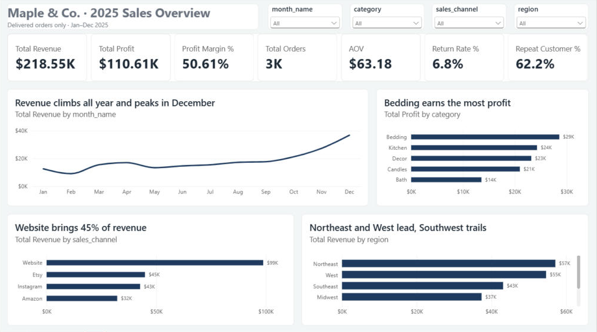
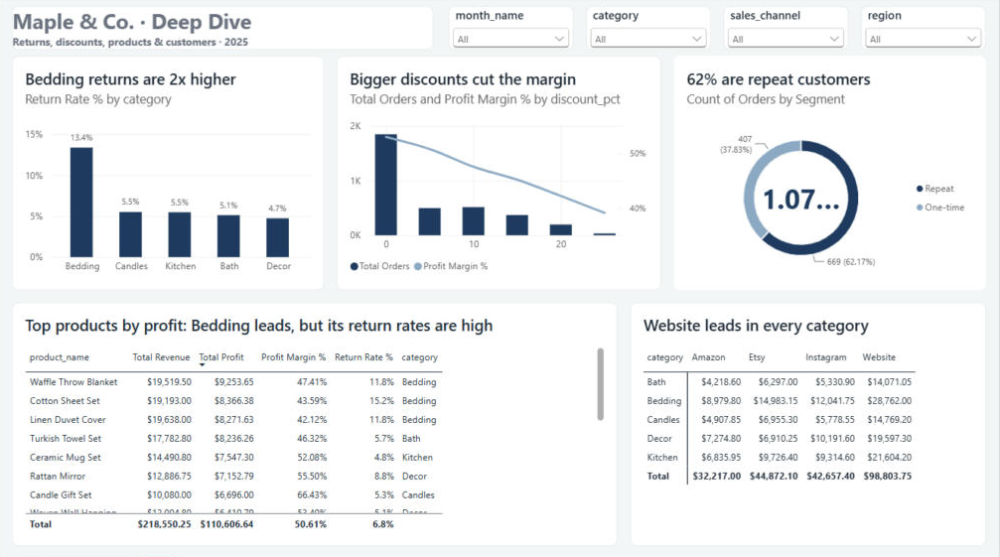

# Maple & Co. — 2025 Sales Insights Report

**Prepared for:** Sarah, Maple & Co. Home Goods
**Prepared by:** Aman Tiwari, Data Analyst
**Date:** 30 October 2026
**Tools:** Python (pandas) · SQL (SQLite) · Power BI

> **Note:** This is a practice project. The client brief and the dataset are simulated, built to work like a real Upwork job.

---

## 1. Summary

In 2025, Maple & Co. earned **$218.6K in revenue** and **$110.6K in gross profit**, a **50.6% margin**, from **3,459 delivered orders**. Sales grow steadily through the year and **double in December**. The biggest problem is **Bedding**: it brings in the most revenue and profit, but customers return it **more than twice as often** as any other category. Discounts above 10% cut margin without making orders bigger.

## 2. Key numbers (delivered orders only)

| KPI | 2025 value |
|---|---|
| Total revenue (after discount) | $218,550 |
| Gross profit | $110,607 |
| Profit margin | 50.6% |
| Delivered orders | 3,459 |
| Average order value (AOV) | $63.18 |
| Return rate (delivered + returned orders) | 6.8% |
| Repeat customers (2+ orders) | 62.2% (669 of 1,076) |
| Average customer rating | 4.13 / 5 |

## 3. Top 5 insights

**1. December is the biggest month, at twice the monthly average.**
December revenue was $36.7K, against a monthly average of $18.2K. November and December together brought in **29% of the whole year's revenue**. February was the weakest month ($9.2K).

**2. Bedding earns the most, but it is also returned the most.**
Bedding brings in 30% of revenue and the most profit ($28.6K). But its **return rate is 13.4%**, while every other category sits between 4.7% and 5.5%. The three most profitable products are all Bedding, with return rates of 11.8%–15.2%.

**3. Candles have the best margin.**
Candles keep **64.7%** of each sale as profit, the highest of any category. Bedding (44.1%) and Bath (45.3%) have the lowest margins.

**4. Bigger discounts shrink both margin and order size.**
Orders with no discount have a 53.0% margin and a $66.97 average order. At 25% off, margin falls to **39.1%** and the average order drops to **$40.64**. Discounts are not making customers buy more.

**5. The website is the main channel, and most customers come back.**
The website brings in **45% of revenue**, more than double Etsy (21%), the next-largest channel. Instagram brings 20% and Amazon 15%. Average order value is similar on every channel ($62–$65). **62% of customers ordered more than once**, which is a strong base for email and loyalty marketing.

Regions: the **Northeast (26%)** and **West (25%)** lead; the **Southwest (10%)** trails.

## 4. Recommendations for 2026

1. **Fix Bedding returns before buying more Bedding stock.** Read the return reasons for the top three products (Waffle Throw Blanket, Cotton Sheet Set, Linen Duvet Cover). Add size charts, fabric close-up photos and care instructions. If the return rate fell to the 5% level of other categories, about 60 fewer orders a year would be returned.
2. **Cap regular discounts at 10% and plan stock for Q4.** Keep deeper discounts for Black Friday only. Order holiday stock by September, because November and December carry almost a third of the year's sales.
3. **Grow the website and reward repeat buyers.** The website is the biggest channel and avoids marketplace fees. Use the 62% repeat-customer base for a simple loyalty email (for example, a thank-you offer on the second order), and push high-margin Candles as add-ons and gift sets.

## 5. Limitations

- **Marketplace and ad costs are not in the data.** Profit on Amazon and Etsy is overstated, because their fees aren't included.
- **One year only.** There is no 2024 data to check whether the December peak happens every year.
- **17% of orders have no customer rating**, so the average rating is based on the orders that do have one.
- **No return reasons** are recorded. I recommend adding this field to the order system.

## 6. Data cleaning summary

The raw export had **4,034 rows**. After cleaning, **3,868 rows** remain (3,459 delivered, 253 returned, 156 cancelled). Main fixes: 9 test orders removed, 130 duplicate rows and 5 repeated order IDs removed, 22 zero or negative quantities removed, 3 typos (quantity 200 → 2) corrected, dates in 3 formats standardised, 604 prices stored as text converted to numbers, and region and channel spellings standardised. The full cleaning log is in `notes.md`.

## 7. Dashboard

The interactive Power BI dashboard (`04_dashboard/maple_sales_dashboard.pbix`) has two pages. **Overview** shows the KPIs, the monthly trend, and revenue by category, channel and region. **Deep Dive** shows returns, discounts, repeat customers, top products and a category × channel matrix. Both pages filter by month, category, channel and region.

