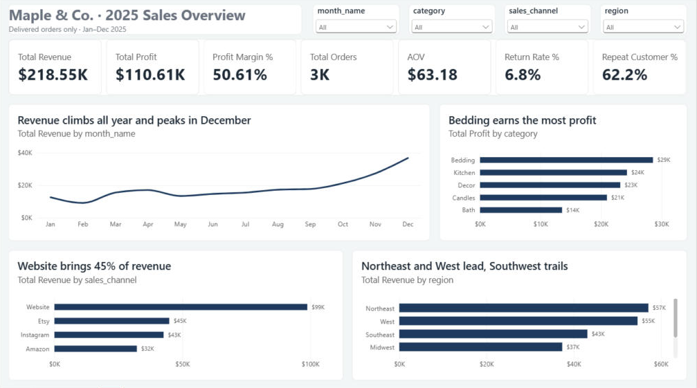
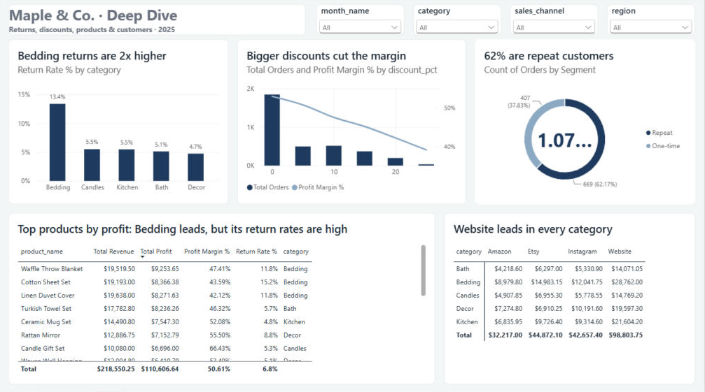

# Maple & Co. — Sales Analysis (Python · SQL · Power BI)

End-to-end analysis of one year of online sales for a small home-goods brand: messy raw data → cleaned dataset → SQL answers to 8 business questions → 2-page interactive Power BI dashboard → client-ready insights report.



> **About this project:** this is a portfolio project built to work like a real freelance job. The client brief ("Sarah", owner of Maple & Co.) and the dataset are simulated. The data was made deliberately messy to practise real-world cleaning.

---

## Business problem

Maple & Co. sells candles, bedding, kitchen, decor and bath products through its website, Instagram, Etsy and Amazon. Before planning 2026, the owner wanted to know **which products, channels and regions deserve more investment, and what to fix or cut.**

The 8 questions the client asked:

1. How much revenue and profit did we make in 2025?
2. How did sales move month by month, and how big were the holidays?
3. Which categories and products bring the most **profit**, not just revenue?
4. Which sales channel performs best?
5. Which regions are strongest and weakest?
6. Which category gets returned the most?
7. Are discounts helping or hurting?
8. Do we have loyal repeat customers?

## Dataset

| File | Rows | Columns | Description |
|---|---|---|---|
| `01_Raw/maple_orders_2025.csv` | 4,034 | 13 | One row per order: date, customer, product, quantity, price, discount, channel, region, payment, status, shipping, rating |
| `01_Raw/maple_products.csv` | 19 | 5 | Product lookup: name, category, unit price, unit cost |

Period: January–December 2025 · Join key: `Product_ID`

## Tools

| Step | Tool |
|---|---|
| Data profiling and cleaning | Python: pandas, NumPy (Jupyter Notebook) |
| Analysis | SQL (SQLite, run from Python) |
| Dashboard | Power BI Desktop: DAX measures, a calculated table, a custom theme |
| Report | Markdown + PDF |

## Process

**1. Profiling** (`03_analysis/01_Sales_Overview.ipynb`)
I checked structure, data types, missing values, duplicates, outliers, text variants and date formats. I found **10+ types of data problems** across both files.

**2. Cleaning** (`03_analysis/02_data_cleaning.ipynb`)

| Issue | Fix | Rows |
|---|---|---|
| Test orders | Removed | 9 |
| Region spelled 7 different ways (NE, North East, west…) | Standardised | 253 |
| Sales channel variants (Web, IG…) | Standardised | 157 |
| Dates in 3 formats | Converted to one date type | 1,308 |
| Prices stored as text with "$" | Converted to numbers | 604 |
| Quantity typos (200) / zero or negative | Fixed / removed | 3 / 22 |
| Invalid rating (6 on a 1–5 scale) | Set to blank | 40 |
| Duplicate rows / repeated order IDs | Removed after text cleaning | 130 / 5 |
| Missing product cost | Filled with client-provided value | 1 |

Then I merged orders with products and added `revenue`, `total_cost`, `profit` and `month`.
**Result: 4,034 → 3,868 clean rows.** The full cleaning log is in [`notes.md`](notes.md).

**3. SQL analysis** (`03_analysis/03_sql_analysis.ipynb`, [`sql/analysis_queries.sql`](sql/analysis_queries.sql))
I answered all 8 questions with SQL: `GROUP BY`, `CASE WHEN` for return rate, and a CTE for repeat customers.

**4. Power BI dashboard** (`04_dashboard/maple_sales_dashboard.pbix`)
- **Overview page:** 7 KPIs, monthly revenue trend, profit by category, revenue by channel and region
- **Deep Dive page:** return rate by category, discount impact (combo chart), repeat vs one-time customers, products ranked by profit, category × channel matrix
- Slicers for month, category, channel and region
- 8 DAX measures (Total Revenue, Total Profit, Profit Margin %, AOV, Return Rate %, Repeat Customer % and more) and a calculated `Customer Segments` table



## Key results

| KPI (delivered orders) | Value |
|---|---|
| Revenue | **$218.6K** |
| Gross profit | **$110.6K** |
| Profit margin | **50.6%** |
| Orders / AOV | **3,459 / $63.18** |
| Return rate | **6.8%** |
| Repeat customers | **62.2%** |

## Top insights

1. **December earns 2× the monthly average.** November and December bring in 29% of the year's revenue.
2. **Bedding is the top earner but has a returns problem.** Its 13.4% return rate is more than double every other category (4.7–5.5%).
3. **Candles have the best margin, at 64.7%.** Highest revenue does not mean best margin.
4. **Bigger discounts hurt.** At 25% off, margin falls from 53% to 39% and average order value drops from $67 to $41.
5. **The website brings in 45% of revenue**, and **62% of customers ordered more than once.**

## Recommendations

1. Fix Bedding returns (size charts, fabric photos, return-reason tracking) before buying more Bedding stock.
2. Cap regular discounts at 10%, and order holiday stock by September.
3. Grow the website channel and use the repeat-customer base for loyalty offers. Push high-margin Candles as add-ons.

📄 Full client report: [`05_deliverables/Maple_Insights_Report.pdf`](05_deliverables/Maple_Insights_Report.pdf)

## Repository structure

```
maple-sales-analysis/
├── 01_Raw/                     # original data (never edited)
├── 02_Cleaned/                 # cleaned CSVs produced by the cleaning notebook
├── 03_analysis/
│   ├── 01_Sales_Overview.ipynb # profiling
│   ├── 02_data_cleaning.ipynb  # cleaning + merge + calculated columns
│   └── 03_sql_analysis.ipynb   # SQL answers to the 8 questions
├── 04_dashboard/
│   └── maple_sales_dashboard.pbix
├── 05_deliverables/
│   ├── Maple_Insights_Report.pdf
│   ├── insights_report.md
│   └── screenshots/
├── sql/analysis_queries.sql
├── notes.md                    # brief, client decisions, cleaning log, findings
└── requirements.txt
```

## How to run

1. Clone the repo and install the packages: `pip install -r requirements.txt`
2. Open the notebooks in `03_analysis/` and run them in order (01 → 02 → 03). File paths are relative.
3. Open `04_dashboard/maple_sales_dashboard.pbix` in Power BI Desktop (free). If it asks, point the data source to `02_Cleaned/orders_cleaned.csv`.

## Limitations

Marketplace fees and ad costs are not in the data, so channel profit on Amazon and Etsy is overstated. There is only one year of data, 17% of orders have no rating, and no return reasons are recorded.

## What I learned

- Remove duplicates **after** cleaning text, because "C1234" and "c1234 " look different until they are standardised.
- Ask the client before making business decisions with the data (what counts as revenue, how to treat returns).
- Write chart titles as findings ("Bedding returns are 2× higher"), not labels ("Return rate by category").

---

**Aman Tiwari** · Data Analyst · Python · SQL · Power BI · Excel
Open to freelance data cleaning, analysis and dashboard projects.
